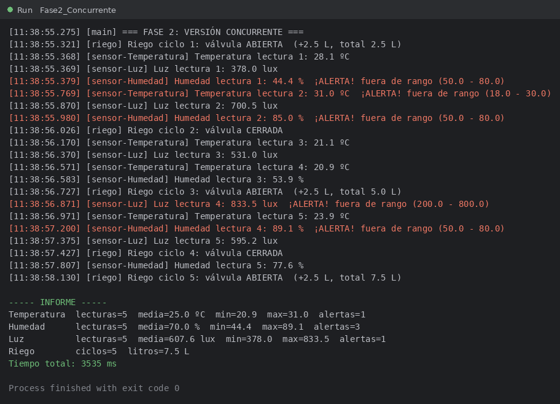
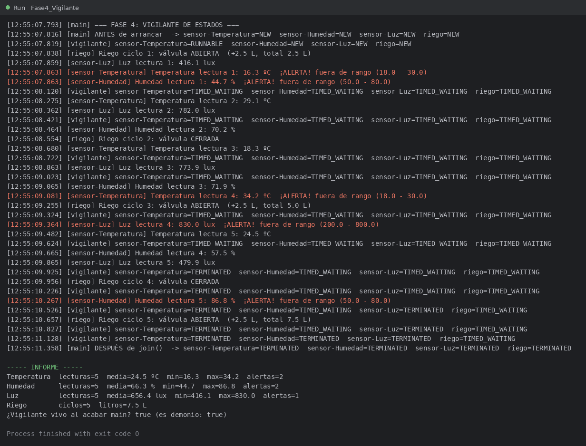

# Invernadero con hilos

Práctica del Tema 4 de PSP (2.º DAM). Sergio Mitchell Bocero.

## Qué hace

Simula el invernadero de Pilar y José: tres sensores (temperatura, humedad y luz) y un programador de riego. Cada sensor toma 5 lecturas con su propio periodo y avisa con una **ALERTA** si el valor se sale del rango correcto. El riego hace 5 ciclos (abre, cierra, abre…) y cada vez que abre riega 2,5 L. Al final se imprime un informe con lecturas, media, mínimo, máximo y alertas de cada sensor y los litros regados.

| Dispositivo | Cada | Genera | Rango correcto | Cómo está hecho |
|---|---|---|---|---|
| Temperatura | 400 ms | 15,0 – 35,0 ºC | 18 – 30 ºC | `Runnable` |
| Humedad | 600 ms | 40,0 – 90,0 % | 50 – 80 % | `Runnable` |
| Luz | 500 ms | 0 – 1000 lux | 200 – 800 lux | `Runnable` |
| Riego | 700 ms | abre / cierra | — | `extends Thread` |

Clases principales (paquete `invernadero`):

- `Sensor`: clase abstracta que implementa `Runnable`, con `medir()` abstracto, sus estadísticas y `informe()`.
- `SensorTemperatura`, `SensorHumedad`, `SensorLuz`: heredan de `Sensor` y generan el valor con `ThreadLocalRandom`.
- `ProgramadorRiego`: hereda de `Thread` y se llama `riego` (`super("riego")` en el constructor).
- `Log`: imprime cada mensaje con la hora y el nombre del hilo (`Thread.currentThread().getName()`).
- `Vigilante`: tarea que muestra el estado de los cuatro hilos cada 300 ms.

## Cómo ejecutarlo

1. Clonar el repositorio y abrir la carpeta en IntelliJ.
2. Poner como SDK del proyecto el **JDK 21** (File → Project Structure → Project).
3. Ejecutar cualquiera de estas clases del paquete `invernadero` (botón ▶ junto al `main`):
   - `Fase1_Secuencial`: todo en el hilo `main`, uno detrás de otro.
   - `Fase2_Concurrente`: un hilo por sensor + el riego, con `join()`.
   - `Fase3_Experimentos`: los experimentos A, B y C.
   - `Fase4_Vigilante`: el vigilante de estados.

Las cuatro terminan solas.

## Captura

Una ejecución de la Fase 2:



Y la de la Fase 4 con el vigilante:



## Resultados

Tiempos medidos con `System.currentTimeMillis()` antes y después:

| Ejecución | Fase 1 (secuencial) | Fase 2 (concurrente) |
|---|---|---|
| 1 | 11078 ms | 3535 ms |
| 2 | 11125 ms | 3541 ms |
| 3 | 11101 ms | 3568 ms |
| **Teórico** | 2000 + 3000 + 2500 + 3500 = **11000 ms** | máximo = riego = **3500 ms** |

La hipótesis se cumple: en secuencial el tiempo es la **suma** de los cuatro y en concurrente es más o menos el del **más lento**, que es el riego (5 × 700 ms). Lo que sobra (unos pocos milisegundos) es lo que tarda Java en arrancar los hilos y en imprimir.

En la Fase 1 todos los mensajes salen con `[main]`, porque al llamar a `run()` directamente no se crea ningún hilo y todo lo hace `main`. En la Fase 2 cada mensaje sale con el nombre de su hilo (`sensor-Temperatura`, `sensor-Humedad`, `sensor-Luz`, `riego`).

**¿Sale siempre en el mismo orden?** No. En mis tres ejecuciones el primer mensaje fue de `riego` en dos de ellas y de `sensor-Luz` en la otra, y el orden de las primeras lecturas fue distinto cada vez (por ejemplo `riego, sensor-Temperatura, sensor-Luz, sensor-Humedad` en una y `sensor-Luz, sensor-Humedad, riego, sensor-Temperatura` en otra). El orden lo decide el planificador y por eso cambia de una ejecución a otra, aunque los periodos sean siempre los mismos.

## Análisis

### ¿Por qué compensa usar hilos en el invernadero?

Porque los sensores pasan casi todo el tiempo **esperando** (`Thread.sleep`) y no calculando. Mientras el sensor de temperatura espera sus 400 ms no tiene sentido que el de humedad no pueda medir. Con hilos, las esperas se solapan y el programa tarda lo que el más lento en vez de la suma (11078 ms → 3535 ms, unas 3 veces menos). Además, en la versión secuencial nadie vigila la temperatura mientras se mide la humedad, que era justo el problema del prototipo de Pilar y José.

### Experimentos A, B y C

**A · Informe sin `join()`**

Se arranca el sensor de temperatura y se imprime su informe justo después, sin esperar.

```
Informe sin esperar  -> Temperatura: 0 lecturas (todavía no ha medido nada)
[12:23:33.746] [sensor-Temperatura] Temperatura lectura 1: 15.4 ºC  ¡ALERTA! fuera de rango (18.0 - 30.0)
...
[12:23:35.358] [sensor-Temperatura] Temperatura lectura 5: 30.8 ºC  ¡ALERTA! fuera de rango (18.0 - 30.0)
Informe tras join()  -> Temperatura  lecturas=5  media=20.9 ºC  min=15.4  max=30.8  alertas=3
```

La primera vez sale con **0 lecturas** porque `main` no espera a nadie: `start()` solo lanza el hilo y vuelve al momento, así que `main` imprime antes de que el sensor haya medido. Después de hacer `join()`, `main` se queda esperando a que el hilo termine y el informe ya sale completo con las 5 lecturas. Es lo mismo que en el Ejemplo 0A, cuando «ha terminado» salía antes de la cuenta atrás.

**B · `run()` en vez de `start()`**

Se crea un riego de 3 ciclos y se llama a `riego.run()`.

```
[12:23:35.777] [main] Riego ciclo 1: válvula ABIERTA  (+2.5 L, total 2.5 L)
[12:23:36.483] [main] Riego ciclo 2: válvula CERRADA
[12:23:37.184] [main] Riego ciclo 3: válvula ABIERTA  (+2.5 L, total 5.0 L)
Tiempo que ha tardado riego.run(): 2122 ms
Estado de riego al final: NEW
```

En el log sale `[main]` y no `[riego]`: llamar a `run()` es una llamada normal a un método, **no crea un hilo nuevo**, así que lo ejecuta `main`. Tarda unos 2100 ms (3 × 700) y `main` se queda bloqueado todo ese tiempo. Al final el estado es **NEW** porque el hilo `riego` nunca se ha arrancado con `start()`: para Java ese hilo todavía no existe.

**C · `start()` dos veces**

Se arranca un riego, se espera con `join()` y se vuelve a llamar a `start()` sobre el mismo objeto.

```
[12:23:37.889] [riego] Riego ciclo 1: válvula ABIERTA  (+2.5 L, total 2.5 L)
[12:23:38.589] [riego] Riego ciclo 2: válvula CERRADA
Estado tras el primer start() y join(): TERMINATED
Excepción capturada: java.lang.IllegalThreadStateException
```

Salta **`IllegalThreadStateException`**. Un hilo solo se puede arrancar una vez: cuando termina pasa a TERMINATED y ya no vuelve a NEW. Si quisiera regar otra vez tendría que crear un objeto `ProgramadorRiego` nuevo.

### Estados observados

| Estado | Cuándo lo he visto | Qué línea lo provoca |
|---|---|---|
| **NEW** | En el «ANTES de arrancar» y en el primer vistazo del vigilante, que a veces llega antes que los `start()` de los sensores | `new Thread(temperatura, "sensor-Temperatura")` y `new ProgramadorRiego()`: el hilo existe pero no se ha arrancado |
| **RUNNABLE** | Solo una vez en tres ejecuciones (`sensor-Temperatura=RUNNABLE` a las 12:55:07.819), justo al arrancar | `start()`, mientras el hilo está midiendo o imprimiendo |
| **TIMED_WAITING** | Casi todo el rato, en los cuatro hilos | `Thread.sleep(periodoMs)` dentro de `run()` |
| **TERMINATED** | Cuando cada hilo acaba sus lecturas o ciclos (primero temperatura, el último el riego) y en el «DESPUÉS de join()» | el final de `run()` |

Lo que esperaba era ver sobre todo TIMED_WAITING, porque los sensores pasan casi todo el tiempo dormidos: medir e imprimir dura microsegundos y el `sleep` dura cientos de milisegundos. Por eso RUNNABLE casi nunca se ve, el vigilante tiene que «pillar» al hilo justo en ese instante.

No aparecen **WAITING** ni **BLOCKED**. WAITING lo tendría el hilo `main` mientras hace `join()` sin tiempo, pero el vigilante no mira a `main`, solo a los cuatro del invernadero. BLOCKED solo pasa al esperar un cerrojo de `synchronized`, y en esta práctica no hay ninguno (eso es de la UD6).

**¿Por qué termina el programa si el vigilante sigue en su bucle?** Porque el hilo del vigilante está marcado con `vigilante.setDaemon(true)` antes de `start()`. La JVM no espera a los hilos demonio: cuando `main` y los cuatro hilos del invernadero acaban, solo queda el vigilante y la JVM se cierra aunque esté dentro del `while (true)`. Al final del informe se ve que el vigilante sigue vivo (`isAlive() = true`) justo antes de que el programa termine. Si quito el `setDaemon(true)`, el programa no termina nunca y hay que pararlo a mano.

### Thread frente a Runnable

| Aspecto | `extends Thread` (riego) | `implements Runnable` (sensores) |
|---|---|---|
| Qué representa el objeto | El propio **hilo**: tarea e hilo van juntos | Solo la **tarea**; el hilo es otro objeto |
| Cómo se arranca | `riego.start()` | `new Thread(sensor, "sensor-Luz").start()` |
| Nombre del hilo | En el constructor con `super("riego")` | Segundo parámetro de `new Thread(tarea, nombre)` |
| Herencia | Gasta la única herencia de Java en `Thread` | Deja libre la herencia (los sensores heredan de `Sensor`) |
| `getName()` dentro de `run()` | Se puede llamar directamente | Hay que usar `Thread.currentThread().getName()` |
| Reutilizar | Un objeto = un hilo, no se puede volver a arrancar | La misma tarea se puede meter en otro `Thread` nuevo |

**¿Por qué los sensores SOLO pueden ser Runnable en mi diseño?** Porque `SensorTemperatura`, `SensorHumedad` y `SensorLuz` ya heredan de `Sensor` (para compartir atributos, estadísticas e `informe()`), y en Java una clase solo puede heredar de una. Como no pueden heredar también de `Thread`, la única opción es que `Sensor` implemente la interfaz `Runnable`.

**¿Qué forma elegiría para el riego y por qué?** En esta práctica el riego es `extends Thread` porque lo pide el enunciado y porque es un caso sencillo: una sola tarea que no necesita heredar de nada más, como el Cohete del Ejemplo 0A. Pero en un proyecto real lo haría también con **Runnable**: separa la tarea del hilo, deja libre la herencia por si más adelante quiero una clase `Dispositivo` común, y es la forma que recomienda el CheatSheet.
